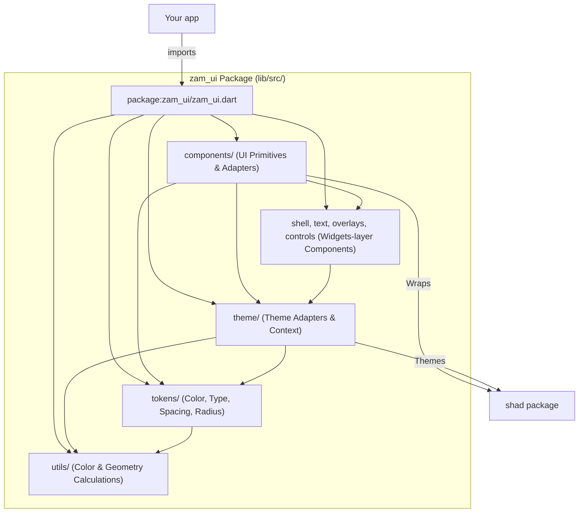

# zam_ui

[](https://github.com/mikezamayias/zam_ui/actions/workflows/main.yaml)
[](https://pub.dev/packages/very_good_analysis)
[](https://opensource.org/licenses/BSD-3-Clause)

A token and theme layer over shad, plus the components Zam apps share.

`zam_ui` provides configurable design tokens, shad theme generation, and
small reusable UI primitives. Apps own their fonts, icon package, routing, state
management, and brand presets.

## Direction in 0.4.0

Apps import `package:zam_ui/zam_ui.dart` and no longer import `shad`.
Every widget an app needs from the kit has a `zam_ui` name and a signature that uses only Flutter and `zam_ui` types.
`zam_ui` keeps `shad` as an implementation detail and pins it to one minor range.

`zam_ui` does not set up Material any more.
`package:zam_ui/zam_ui.dart` imports no Material and no Cupertino library, and `ZamApp` no longer inserts a Material theme.
An app that still renders Material widgets wraps them in `ZamMaterial` from `package:zam_ui/material.dart`:

```dart
import 'package:zam_ui/material.dart';

ZamApp(
  builder: (context, child) => ZamMaterial(child: child!),
  home: const HomePage(),
);
```

`ZamMaterial` is deprecated and temporary.
It exists so an app can move off Material one screen at a time, and it is removed in 0.5.0.

## Architecture

Dependencies flow one way: utils, then tokens, then theme, then components. Each layer imports only the layers before it.
The shell, text, overlays and controls libraries hold the widgets-layer components, and components build on them.
`ZamApp` in theme uses `ZamPageRoute` and `ZamScrollBehavior` from shell, so those two libraries and theme import each other.



- **Tokens (`lib/src/tokens/`)**: Immutable design values (`ZamColorTokens`, `ZamTypographyTokens`, `ZamSpacingTokens`, etc.). They hold values and build no widgets.
- **Theme (`lib/src/theme/`)**: Bridges design tokens to the widget tree (`ZamTheme`, `ZamThemeData`, `ZamPreset`) and adapts to `ShadThemeData`.
- **Components (`lib/src/components/`)**: Visual UI primitives (`ZamButton`, `ZamSurface`, `ZamListTile`, `ZamFormField`, `ZamDialog`) built on shad.
- **Shell, text, overlays, controls (`lib/src/shell/`, `text/`, `overlays/`, `controls/`)**: The widgets an app shell, an input, a dialog or a control needs, built on the Flutter widgets layer and on shad. See [Components by library](#components-by-library).
- **Utils (`lib/src/utils/`)**: Standalone mathematical color & geometry utilities (`ZamColorUtils`, `ZamOklchColor`).

## Install

Local development:

```yaml
dependency_overrides:
  zam_ui:
    path: ../zam_ui
```

Git dependency:

```yaml
dependencies:
  zam_ui:
    git:
      url: https://github.com/mikezamayias/zam_ui.git
      ref: v0.4.2
```

`zam_ui` is not on pub.dev. Install it from git with a version tag.
0.4.0 requires Flutter 3.50.0 and Dart 3.14.0.

## Configure

```dart
final ui = ZamThemeData(
  colors: ZamColorTokens.fromSeed(primary: brandColor),
  typography: const ZamTypographyTokens(
    fontFamily: 'Inter',
    monoFontFamily: 'JetBrains Mono',
  ),
  icons: ZamIconSet(
    info: MyIcons.info,
    success: MyIcons.check,
    warning: MyIcons.warning,
    error: MyIcons.error,
    back: MyIcons.back,
    chevronRight: MyIcons.chevronRight,
  ),
);

ZamApp.router(
  theme: ui,
  darkTheme: ui,
  routerConfig: router,
);
```

`ZamApp` scopes the light or dark `ZamThemeData` for the active brightness.
`themeMode` takes a `ZamThemeMode` (`system`, `light` or `dark`).
It does not set up Material, so wrap Material widgets in `ZamMaterial` as described above.
By default it navigates with `ZamPageRoute` and scrolls with `ZamScrollBehavior`.
Pass `pageRouteBuilder` or `scrollBehavior` to change either.

### Components by library

All of these come from `package:zam_ui/zam_ui.dart`.

| Library | Widgets and functions |
| --- | --- |
| Shell | `ZamScaffold`, `ZamPageRoute`, `ZamPageTransition`, `ZamScrollBehavior`, `ZamScrollbar` |
| Text | `ZamTextField`, `ZamTextSelectionControls`, `ZamSelectionArea` |
| Overlays | `showZamDialog`, `ZamDialogSurface`, `showZamSheet`, `ZamSheetSide`, `ZamToast` (`show`, `showCustom`, `hide`), `ZamToaster`, `ZamTooltip` |
| Controls | `ZamPressable`, `ZamSpinner`, `ZamProgress`, `ZamCheckbox`, `ZamReorderableList`, `ZamReorderLabels` |
| Palette and roles | `ZamPalette`, `context.zamPalette`, `ZamThemeData.palette`, `ZamThemeData.oled`, the optional roles of `ZamSurfaceColors`, `ZamTypographyTokens.fontFamilyFallback` |

- **Shell**: `ZamScaffold` fills its box, places an optional bottom bar and handles the keyboard inset.
  `ZamPageRoute` slides in on iOS and macOS with an edge swipe back, and fades in elsewhere.
- **Text**: `ZamTextField` is unstyled, so the app draws the box around it.
  It keeps selection handles, a magnifier and the platform edit menu on touch devices.
- **Overlays**: `showZamDialog` fades in without blur by default, and `showZamSheet` builds the sheet frame itself, so the builder returns content only.
  `ZamToast.showCustom` shows any widget without the kit's padding, border or background.
  `ZamToaster` restores the toaster for a subtree that replaces the `ZamApp` builder child.
- **Controls**: `ZamReorderableList` takes its screen reader wording from `ZamReorderLabels`, because it relies on no localization delegate.
  `ZamPressable` has no semantics label or role, so callers add their own.
- **Palette and roles**: `ZamPalette` resolves every role to a non-null color for one brightness.
  The optional `ZamSurfaceColors` roles resolve to the values `ZamApp` computed in 0.3.0 when left null, so an app that sets none sees no change.

### Icons, dates and animations

`zam_ui` no longer re-exports `lucide_icons_flutter`, `intl` or `flutter_animate`.
Apps that use them add them to their own `pubspec.yaml` and import them directly.

### shad

`zam_ui` does not re-export `shad`, and apps no longer need it.
`zam_ui` adds no localization delegate of its own.
`ZamApp` relies on shad's delegate and the widgets delegate, and components that need app wording take labels as parameters.
`ZamTheme.shadOf` stays for an app that still imports `shad` itself.
Such an app adds `shad: ">=1.0.2 <1.1.0"` to its own `pubspec.yaml`.

### Fonts

`zam_ui` only consumes font family names through `ZamTypographyTokens`. Each
app is responsible for loading or registering those fonts before using them,
usually in the app's own `pubspec.yaml`:

```yaml
flutter:
  fonts:
    - family: Inter
      fonts:
        - asset: assets/fonts/Inter-Regular.ttf
        - asset: assets/fonts/Inter-SemiBold.ttf
          weight: 600
    - family: JetBrains Mono
      fonts:
        - asset: assets/fonts/JetBrainsMono-Regular.ttf
```

Then reference the family names from the app preset:

```dart
typography: const ZamTypographyTokens(
  fontFamily: 'Inter',
  monoFontFamily: 'JetBrains Mono',
),
```

### Brand Presets

Implement the `ZamPreset` interface to define type-safe brand configurations
for your app:

```dart
class MyAppPreset implements ZamPreset {
  const MyAppPreset();

  @override
  String get name => 'My App';

  @override
  ZamThemeData get light => ZamThemeData(
    colors: ZamColorTokens.fromSeed(primary: brandColor),
    typography: const ZamTypographyTokens(
      fontFamily: 'Inter',
      monoFontFamily: 'JetBrains Mono',
    ),
    icons: myIcons,
  );

  @override
  ZamThemeData get dark => light;
}
```

Then use the preset to configure `ZamApp`:

```dart
const preset = MyAppPreset();

ZamApp.router(
  theme: preset.light,
  darkTheme: preset.dark,
  routerConfig: router,
);
```

## Upgrading from 0.3.0

Breaking changes:

- Requires Flutter 3.50.0 and Dart 3.14.0.
- `ZamApp` no longer sets up Material and no longer uses `MaterialPageRoute`.
  Wrap Material widgets in `ZamMaterial`, as in [Direction in 0.4.0](#direction-in-040).
- `ZamApp.themeMode` takes a `ZamThemeMode` instead of Material's `ThemeMode`.
- `ZamApp` sets a root `DefaultTextStyle` from the theme, so an unstyled `Text` now uses the theme font and its fallback instead of the platform font.
- `ZamApp` scrolls with `ZamScrollBehavior` by default, which draws a `ZamScrollbar` on every platform except Android and Fuchsia.
  Pass your own `scrollBehavior` to change it.
- The `ZamX = ShadX` typedefs are removed: `ZamBadge`, `ZamBorder`, `ZamCalendar`, `ZamCard`, `ZamColorScheme`, `ZamDecoration`, `ZamDialogVariant`, `ZamInput`, `ZamInputOTP`, `ZamInputOTPGroup`, `ZamInputOTPSlot`, `ZamRadio`, `ZamRawDialog`, `ZamSheet`, `ZamSlider`, `ZamSliderController`, `ZamSonner`, `ZamSwitch`, `ZamTab`, `ZamTabs` and `ZamTextTheme`, together with `ZamResolvedColorScheme`, `ZamResolvedTheme` and `ZamResolvedThemeData`.
  Import `package:shad/shad.dart` for these, or move to the new widgets.
- `ZamCheckbox`, `ZamProgress`, `ZamSheetSide` and `ZamTooltip` keep their names but are new `zam_ui` widgets and types, no longer typedefs of the shad ones.
- `showZamDialog` loses `variant`, `animateIn`, `animateOut` and `anchorPoint`, and it enters with a fade and no blur.
  `showZamSheet` loses `shape`, `animateIn`, `animateOut` and `anchorPoint`, takes a `ZamSheetSide`, and builds the sheet frame itself.
  Both default `barrierLabel` to shad's localized "Dismiss".

Each optional palette role resolves to its 0.3.0 value when left alone.

## Continuous integration

CI runs by hand on a self-hosted runner, against protected `main` only.
Pull requests are not tested automatically.
The workflow has no secrets, writes nothing to the repository, and refuses any branch other than `main`.

## Verify

The authoritative SDK contract is [`.github/toolchain.json`](.github/toolchain.json).
Verification fails before dependency resolution unless the selected Flutter SDK and its Flutter-owned Dart SDK match that contract exactly.

```bash
ruby scripts/verify_toolchain.rb .github/toolchain.json
ruby test/workflow_policy_test.rb
actionlint .github/workflows/main.yaml
flutter pub get
dart format --output=none --set-exit-if-changed .
flutter analyze
dart run scripts/check_design_tokens.dart --self-test
dart run scripts/check_design_tokens.dart
flutter test --coverage
```
