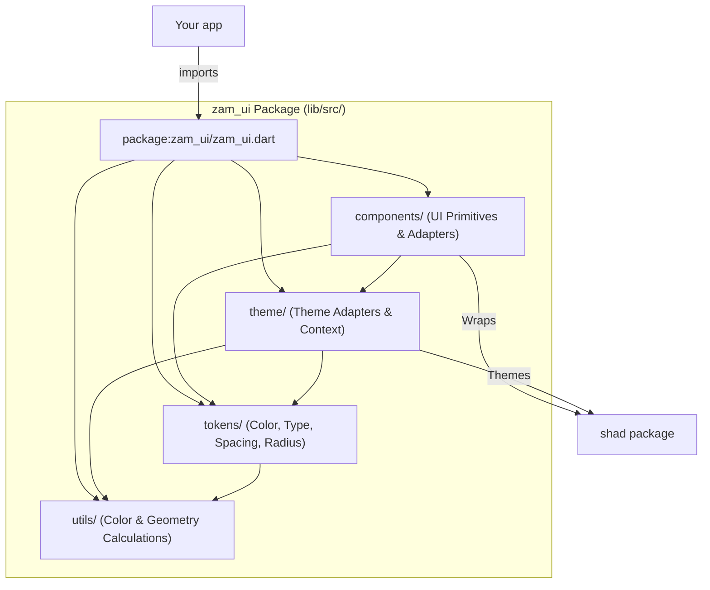

# zam_ui

[](https://github.com/mikezamayias/zam_ui/actions/workflows/main.yaml)
[](https://pub.dev/packages/very_good_analysis)
[](https://opensource.org/licenses/BSD-3-Clause)

A token and theme layer over shad, plus the components Zam apps share.

`zam_ui` provides configurable design tokens, shad theme generation, and
small reusable UI primitives. Apps own their fonts, icon package, routing, state
management, and brand presets.

## Architecture

Dependencies flow one way: utils, then tokens, then theme, then components. Each layer imports only the layers before it.



- **Tokens (`lib/src/tokens/`)**: Immutable design values (`ZamColorTokens`, `ZamTypographyTokens`, `ZamSpacingTokens`, etc.). They hold values and build no widgets.
- **Theme (`lib/src/theme/`)**: Bridges design tokens to the widget tree (`ZamTheme`, `ZamThemeData`, `ZamPreset`) and adapts to `ShadThemeData`.
- **Components (`lib/src/components/`)**: Visual UI primitives (`ZamButton`, `ZamSurface`, `ZamListTile`, `ZamFormField`, `ZamDialog`) built on shad. Use shad widgets such as `ShadCard` and `ShadInput` directly, and `ZamApp` themes them from your tokens.
- **Utils (`lib/src/utils/`)**: Standalone mathematical color & geometry utilities (`ZamColorUtils`, `ZamOklchColor`).

## Install

Local development:

```yaml
dependency_overrides:
  zam_ui:
    path: ../zam_ui
```

Git dependency:

```yaml
dependencies:
  zam_ui:
    git:
      url: https://github.com/mikezamayias/zam_ui.git
      ref: v0.3.0
```

`zam_ui` is not on pub.dev. Install it from git with a version tag.

## Configure

```dart
final ui = ZamThemeData(
  colors: ZamColorTokens.fromSeed(primary: brandColor),
  typography: const ZamTypographyTokens(
    fontFamily: 'Inter',
    monoFontFamily: 'JetBrains Mono',
  ),
  icons: ZamIconSet(
    info: MyIcons.info,
    success: MyIcons.check,
    warning: MyIcons.warning,
    error: MyIcons.error,
    back: MyIcons.back,
    chevronRight: MyIcons.chevronRight,
  ),
);

ZamApp.router(
  theme: ui,
  darkTheme: ui,
  routerConfig: router,
);
```

`ZamApp` scopes the light or dark `ZamThemeData` for the active brightness.
It also sets up Material, so Material widgets and page routes keep working.

### Icons, dates and animations

`zam_ui` no longer re-exports `lucide_icons_flutter`, `intl` or `flutter_animate`.
Apps that use them add them to their own `pubspec.yaml` and import them directly.

### shad widgets

`zam_ui` does not re-export `shad`.
Apps that use shad widgets such as `ShadCard` add `shad: ">=1.0.2 <1.1.0"` to their own `pubspec.yaml` and import `package:shad/shad.dart`.
`ZamApp` themes those widgets from the app's tokens.

### Fonts

`zam_ui` only consumes font family names through `ZamTypographyTokens`. Each
app is responsible for loading or registering those fonts before using them,
usually in the app's own `pubspec.yaml`:

```yaml
flutter:
  fonts:
    - family: Inter
      fonts:
        - asset: assets/fonts/Inter-Regular.ttf
        - asset: assets/fonts/Inter-SemiBold.ttf
          weight: 600
    - family: JetBrains Mono
      fonts:
        - asset: assets/fonts/JetBrainsMono-Regular.ttf
```

Then reference the family names from the app preset:

```dart
typography: const ZamTypographyTokens(
  fontFamily: 'Inter',
  monoFontFamily: 'JetBrains Mono',
),
```

### Brand Presets

Implement the `ZamPreset` interface to define type-safe brand configurations
for your app:

```dart
class MyAppPreset implements ZamPreset {
  const MyAppPreset();

  @override
  String get name => 'My App';

  @override
  ZamThemeData get light => ZamThemeData(
    colors: ZamColorTokens.fromSeed(primary: brandColor),
    typography: const ZamTypographyTokens(
      fontFamily: 'Inter',
      monoFontFamily: 'JetBrains Mono',
    ),
    icons: myIcons,
  );

  @override
  ZamThemeData get dark => light;
}
```

Then use the preset to configure `ZamApp`:

```dart
const preset = MyAppPreset();

ZamApp.router(
  theme: preset.light,
  darkTheme: preset.dark,
  routerConfig: router,
);
```

## Continuous integration

CI runs by hand on a self-hosted runner, against protected `main` only.
Pull requests are not tested automatically.
The workflow has no secrets, writes nothing to the repository, and refuses any branch other than `main`.

## Verify

The authoritative SDK contract is [`.github/toolchain.json`](.github/toolchain.json).
Verification fails before dependency resolution unless the selected Flutter SDK and its Flutter-owned Dart SDK match that contract exactly.

```bash
ruby scripts/verify_toolchain.rb .github/toolchain.json
ruby test/workflow_policy_test.rb
actionlint .github/workflows/main.yaml
flutter pub get
dart format --output=none --set-exit-if-changed .
flutter analyze
dart run scripts/check_design_tokens.dart --self-test
dart run scripts/check_design_tokens.dart
flutter test --coverage
```
